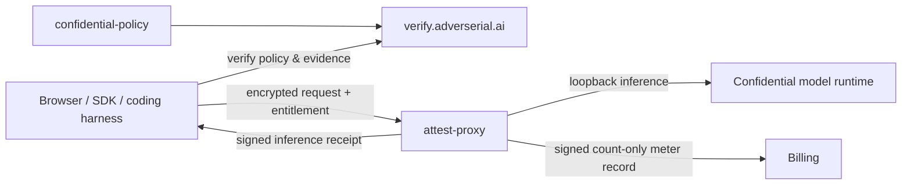

# Adverserial AI

### Confidential AI infrastructure for security teams

Build and use advanced AI systems while independently verifying the runtime that processes sensitive work.

[Website](https://adverserial.ai) · [Confidential Computing](https://adverserial.ai/confidential/) · [Verification Center](https://verify.adverserial.ai) · [Documentation](https://adverserial.ai/documentation) · [Confidential Chat](https://chat.adverserial.ai)

---

## What we build

Adverserial AI builds confidential inference systems for cybersecurity work.
Supported clients verify published policy, fresh hardware evidence, and
quote-bound transport keys before confidential data is sent. The runtime returns
signed inference receipts so a completed request can be checked against the
same public policy.

| Capability | What it means |
| --- | --- |
| **Verified runtime** | Clients validate published policy, Intel TDX evidence, NVIDIA GPU evidence, release identity, and quote-bound keys before confidential inference. |
| **Encrypted prompt path** | Supported clients encrypt requests to the attested runtime. The public endpoint accepts a scoped entitlement rather than a user API credential. |
| **Auditable output** | Each completed confidential inference carries a signed receipt that can be reviewed in the Verification Center. |
| **Local conversation storage** | The confidential Open WebUI distribution stores saved conversations in the browser's IndexedDB, with an opt-in temporary-chat mode. |

## Public repository map

| Repository | Purpose | Tags |
| --- | --- | --- |
| [attest-proxy](https://github.com/AdverserialAI/attest-proxy) | Attested ingress that validates scoped entitlements, handles encrypted request bodies, calls local inference, and emits signed receipts and meter records. | `Go` `TDX` `NVIDIA` `EHBP` `SGLang` |
| [confidential-sdk](https://github.com/AdverserialAI/confidential-sdk) | TypeScript and Python SDKs, local gateway, verifier CLI, and integrations for Claude Code, Codex, OpenCode, Kimi Code, Pi, and Hermes. | `TypeScript` `Python` `CLI` `Plugins` |
| [confidential-policy](https://github.com/AdverserialAI/confidential-policy) | Public policies and release manifests used by independent verifiers. | `Policies` `Digests` `Provenance` |
| [confidential-meter-ingress](https://github.com/AdverserialAI/confidential-meter-ingress) | mTLS meter ingress that verifies proxy-signed, count-only settlement records. | `Go` `mTLS` `Ed25519` `Metering` |
| [confidential-infra](https://github.com/AdverserialAI/confidential-infra) | Reproducible confidential runtime composition and deployment documentation. | `Docker` `CVM` `Operations` |
| [confidential-open-webui](https://github.com/AdverserialAI/confidential-open-webui) | Confidential-only Open WebUI distribution with browser-local conversations and a built-in Verification Center. | `Open WebUI` `IndexedDB` `Verification` |
| [confidential-chat](https://github.com/AdverserialAI/confidential-chat) | Lightweight browser client and release-provenance tooling for confidential inference. | `Browser` `EHBP` `Receipts` |

## How the public components fit together

## Start here

- **Use a coding harness:** follow the [SDK installation and plugin guide](https://github.com/AdverserialAI/confidential-sdk#readme).
- **Verify a deployed runtime:** open the [Verification Center](https://verify.adverserial.ai) and compare evidence with the published [policy and manifests](https://github.com/AdverserialAI/confidential-policy).
- **Review the confidentiality model:** see [How confidential inference works](https://adverserial.ai/confidential/).
- **Report a vulnerability privately:** email [security@adverserial.ai](mailto:security@adverserial.ai). Do not disclose suspected vulnerabilities in public issues.

## Source availability and licensing

Public repositories enable independent review, verification tooling, and client
integrations. Unless a repository identifies upstream or third-party terms,
Adverserial-authored code is source-available proprietary software licensed
for use only through a separate written agreement with Adverserial AI LLC.

The Open WebUI-derived repositories retain their upstream Open WebUI license
and attribution. Third-party components retain their own notices and licenses.
See each repository's `LICENSE`, `LICENSING.md`, and `THIRD_PARTY_NOTICES.md`
where present.

---

© 2026 Adverserial AI LLC. All rights reserved.
