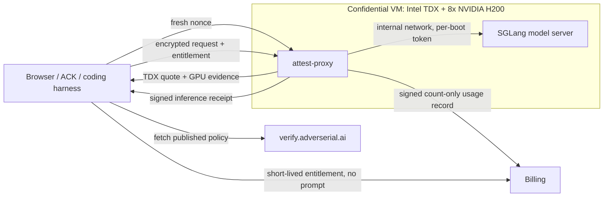

<div align="center">

# Adverserial AI

### Confidential AI infrastructure for security teams

Build and use advanced AI systems while independently verifying the runtime that processes sensitive work.

[Website](https://adverserial.ai) · [Confidential Computing](https://adverserial.ai/confidential/) · [Verification Center](https://verify.adverserial.ai) · [Documentation](https://adverserial.ai/documentation) · [Confidential Chat](https://chat.adverserial.ai)

</div>

---

## What we build

Adverserial AI builds confidential inference systems for cybersecurity work.
Supported clients verify published policy, fresh hardware evidence, and
quote-bound transport keys before confidential data is sent. The runtime returns
signed inference receipts so a completed request can be checked against the
same public policy.

| Capability | What it means |
| --- | --- |
| **Verified runtime** | Clients validate published policy, Intel TDX evidence, NVIDIA GPU evidence, release identity, and quote-bound keys before confidential inference. The runtime's signing and encryption keys are generated inside the confidential VM. |
| **Encrypted prompt path** | Supported clients encrypt requests to the attested runtime. The public endpoint accepts a scoped entitlement rather than a user API credential. |
| **Auditable output** | Each completed confidential inference carries a signed receipt that can be reviewed in the Verification Center. |
| **Local conversation storage** | The confidential Open WebUI distribution stores saved conversations in the browser's IndexedDB, with an opt-in temporary-chat mode. |

## Meet ACK · the Confidential Console

[**Adverserial Confidential Kit →**](https://github.com/AdverserialAI/adverserial-confidential-kit)

One setup for confidential coding with **Claude Code, Codex, OpenCode, Pi,
Oh My Pi, ZCode, DeepSeek Harness, Hermes and Kimi Code**.

```sh
npm install -g github:AdverserialAI/adverserial-confidential-kit
ack init
ack code
```

Enter your API key once; ACK prepares the local gateway and matching verification
policy. Run `ack` for the interactive console, or use direct commands.

| In the console | What you get |
| --- | --- |
| **Code** | Searchable harness picker, installed-tool detection and terminal handoff. |
| **Vault** | Named API keys, masked entry, add/replace/switch/delete, AES-256-GCM encryption with the storage key held in macOS Keychain or protected by Windows DPAPI. |
| **Models** | Public model discovery and activation with an active matching policy. |
| **Attestation** | Fresh hardware and pinned-receipt verification; evidence expiry is visible. |
| **Swarms** | Selected harness workers, shared local briefs and explicit collaboration rooms. |
| **Workspace** | Diagnostics, runtime lifecycle management, colorful ASCII branding and four console themes. |

ACK currently requires **macOS or Windows, Node.js 18+, Python 3.10+**, an Adverserial API
key and separately installed harness CLIs. Native verification commands and
footers depend on the harness; the [integration guide](https://github.com/AdverserialAI/adverserial-confidential-kit#coding-harnesses)
documents each one. The source install above is available now; npm registry
installation is documented for the first published release.

[Installation](https://github.com/AdverserialAI/adverserial-confidential-kit#install--initialize--code) ·
[Harness integrations](https://github.com/AdverserialAI/adverserial-confidential-kit#coding-harnesses) ·
[Verification](https://github.com/AdverserialAI/adverserial-confidential-kit#attestation-and-verification) ·
[Encrypted vault](https://github.com/AdverserialAI/adverserial-confidential-kit#encrypted-api-key-profiles) ·
[Collaboration](https://github.com/AdverserialAI/adverserial-confidential-kit#confidential-swarms) ·
[License](https://github.com/AdverserialAI/adverserial-confidential-kit/blob/main/LICENSE)

## Public repository map

| Repository | Purpose | Tags |
| --- | --- | --- |
| [adverserial-confidential-kit](https://github.com/AdverserialAI/adverserial-confidential-kit) | ACK: interactive confidential console, encrypted key vault, gateway lifecycle, model selection and multi-harness collaboration. | `Node.js` `CLI` `Vault` `Agents` |
| [attest-proxy](https://github.com/AdverserialAI/attest-proxy) | The server that runs inside the confidential VM: terminates TLS, serves attestation evidence, validates scoped entitlements, decrypts request bodies, calls the model server, and signs receipts and usage records. Also the source of the GPU evidence collector and model measurer images. | `Go` `TDX` `NVIDIA` `EHBP` `SGLang` |
| [confidential-infra](https://github.com/AdverserialAI/confidential-infra) | Deployment documentation. [`deployed/`](https://github.com/AdverserialAI/confidential-infra/tree/main/deployed) holds the Docker Compose file running in production and explains each service and how its hashes are computed. The rest is the October 2026 template, kept as history. | `Docker` `CVM` `Operations` |
| [confidential-open-webui](https://github.com/AdverserialAI/confidential-open-webui) | Source of [chat.adverserial.ai](https://chat.adverserial.ai): a confidential-only Open WebUI distribution with browser-local conversations and a built-in Verification Center. | `Open WebUI` `IndexedDB` `Verification` |
| [confidential-sdk](https://github.com/AdverserialAI/confidential-sdk) | TypeScript and Python verification libraries, local gateway, verifier CLI, and harness plugins. Not updated since October 2026 and still targets an earlier model; the maintained copy ships inside adverserial-confidential-kit. | `TypeScript` `Python` `CLI` `Plugins` |
| [confidential-policy](https://github.com/AdverserialAI/confidential-policy) | Policy and release-manifest schemas, a validator, and older policy templates. **Not the live policy**: that is published at [verify.adverserial.ai/policies/production.json](https://verify.adverserial.ai/policies/production.json). | `Schemas` `Templates` |
| [confidential-meter-ingress](https://github.com/AdverserialAI/confidential-meter-ingress) | Optional mTLS ingress for proxy-signed, count-only usage records. **Not used in production**, where the proxy posts signed records directly to billing. | `Go` `mTLS` `Ed25519` `Metering` |
| [confidential-chat](https://github.com/AdverserialAI/confidential-chat) | The earlier lightweight static browser client. **Not deployed**; superseded by confidential-open-webui. | `Browser` `EHBP` `Receipts` |
| cyberseek-transparency | Independent Python verifier, hash-chained attestation history and deployment files for the production service. Being published. | `Python` `Verifier` `Transparency` |

## Open-source security agents we maintain

These repositories are the security-agent distributions we actively maintain.
Forks preserve their upstream license and attribution; release artifacts from our
distributions are published from the linked AdverserialAI repositories.

| Agent | Maintained repository | Origin | License | Focus |
| --- | --- | --- | --- | --- |
| ARTEX Attack | [AdverserialAI/artex-attack](https://github.com/AdverserialAI/artex-attack) | [Autumn-27/ARTEX](https://github.com/Autumn-27/ARTEX) | AGPL-3.0 | English offensive-security distribution with confidential model provisioning and signed container releases. |
| ARTEX Defense | [AdverserialAI/artex-defense](https://github.com/AdverserialAI/artex-defense) | ARTEX-derived defensive distribution | AGPL-3.0 | English defensive-security distribution with confidential model provisioning and signed container releases. |
| Cairn | [AdverserialAI/Cairn](https://github.com/AdverserialAI/Cairn) | [oritera/Cairn](https://github.com/oritera/Cairn) | AGPL-3.0 | English multi-agent orchestration with confidential per-worker model provisioning. |
| CyberStrikeAI | [AdverserialAI/CyberStrikeAI](https://github.com/AdverserialAI/CyberStrikeAI) | [AIPentest/CyberStrikeAI](https://github.com/AIPentest/CyberStrikeAI) | Apache-2.0 | AI-assisted penetration-testing agent. |
| PentAGI | [AdverserialAI/pentagi](https://github.com/AdverserialAI/pentagi) | [vxcontrol/pentagi](https://github.com/vxcontrol/pentagi) | MIT | Autonomous penetration-testing system. |
| HexStrike AI | [AdverserialAI/hexstrike-ai](https://github.com/AdverserialAI/hexstrike-ai) | [0x4m4/hexstrike-ai](https://github.com/0x4m4/hexstrike-ai) | MIT | AI security-tool orchestration and MCP server. |
| Decepticon | [AdverserialAI/Decepticon](https://github.com/AdverserialAI/Decepticon) | [BitterSecurity/Decepticon](https://github.com/BitterSecurity/Decepticon) | Apache-2.0 | Autonomous security-testing agent. |

## How the public components fit together



The service runs in one Intel TDX confidential VM on Phala Cloud with eight
NVIDIA H200 GPUs in confidential mode. `api.adverserial.ai` reaches it through
a gateway that passes TLS bytes through; TLS ends in `attest-proxy` inside the
VM. The model server has no published port. Since `attest-proxy`
`v0.1.0-rc.31` the receipt, meter, encryption and TLS keys are all generated
inside the VM; earlier releases used seeds generated by the operator. The
published policy is served over HTTPS and is not itself signed; receipts are.

## Start here

- **Start confidential coding:** install [ACK and choose a harness](https://github.com/AdverserialAI/adverserial-confidential-kit#readme).
- **Build a custom integration:** read the [TypeScript/Python SDK](https://github.com/AdverserialAI/confidential-sdk#readme) for the protocol, and take current code from the kit, which carries the maintained copy.
- **Verify a deployed runtime:** open the [Verification Center](https://verify.adverserial.ai) and compare evidence with the published [policy](https://verify.adverserial.ai/policies/production.json) and [release manifests](https://verify.adverserial.ai/releases/index.json).
- **See exactly what is deployed:** read the [production Docker Compose file and its explanation](https://github.com/AdverserialAI/confidential-infra/tree/main/deployed).
- **Review the confidentiality model:** see [How confidential inference works](https://adverserial.ai/confidential/).
- **Report a vulnerability privately:** email [security@adverserial.ai](mailto:security@adverserial.ai). Do not disclose suspected vulnerabilities in public issues.

## Source availability and licensing

Public repositories enable independent review, verification tooling, and client
integrations. Unless a repository identifies upstream or third-party terms,
Adverserial-authored code is source-available proprietary software licensed
for use only through a separate written agreement with Adverserial AI LLC.

The Open WebUI-derived repositories retain their upstream Open WebUI license
and attribution. Third-party components retain their own notices and licenses.
See each repository's `LICENSE`, `LICENSING.md`, and `THIRD_PARTY_NOTICES.md`
where present.

---

<sub>© 2026 Adverserial AI LLC. All rights reserved.</sub>
